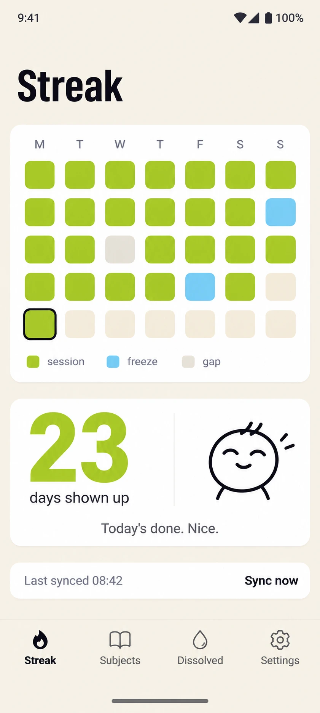

# My Learning Manager

My Learning Manager is a personal Android app for tracking daily learning without turning a missed day into an all-or-nothing reset. It keeps the current streak visible on the home screen, works from a local cache, and reads session data from a small Supabase backend.

## Screenshot



<sub>Concept render of the Streak screen.</sub>

## What it does

- Shows a home-screen widget whose mood escalates through the day until a learning session is logged.
- Draws a streak calendar with one automatic freeze per week, while later missed days remain visible as gaps.
- Reads screens and widgets from a Room cache so the tracking view remains available offline.
- Syncs sessions and mastery data from Supabase while keeping writes behind an authenticated Edge Function.

## Stack

- Kotlin, Jetpack Compose and Jetpack Glance
- Room, DataStore, WorkManager and Ktor
- Supabase Postgres and Edge Functions

## Run it locally

You need JDK 17 and an Android SDK with API 37 installed.

1. Copy `local.properties.example` to `local.properties`.
2. Replace the Supabase placeholders if you want live sync. The app still builds without them.
3. Build the debug APK:

```powershell
.\gradlew.bat assembleDebug
```

The APK is written to `app/build/outputs/apk/debug/app-debug.apk`.

The `supabase` folder contains the database migration and Edge Function. `supabase/deploy.ps1` can apply them and connect a separate learning logger after `.env.example` has been copied to `.env` and filled with a Supabase access token.

## Licence

This project is available under the [MIT License](LICENSE).
